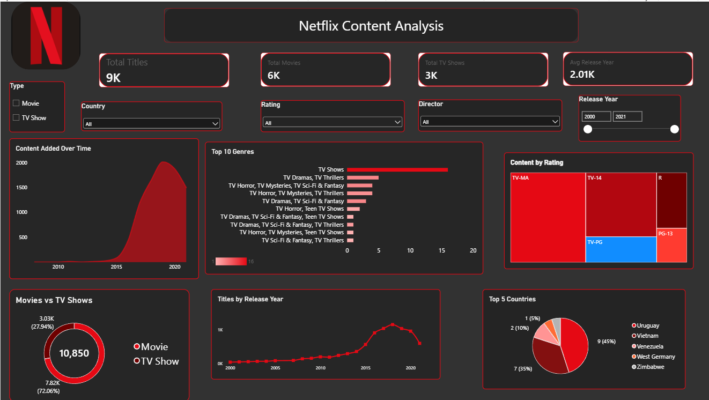

# SWYNEX Interactive Dashboard – Netflix Content Analysis

An interactive Power BI dashboard analyzing Netflix's content library (9,000+ titles), built as **Task 3** of the Data Analyst Internship at **SWYNEX Technologies**.

## 📌 Project Overview

This dashboard explores Netflix's Movies and TV Shows dataset to uncover trends in content type, genre popularity, ratings, release years, and country-wise distribution. It was designed to communicate key insights clearly through KPIs, visuals, and interactive filters.

## 🖼️ Dashboard Preview

## 🛠️ Tools Used

- **Power BI Desktop** – data modeling, DAX measures, and dashboard design

## 📊 Dashboard Features

**KPI Cards**
- Total Titles
- Total Movies
- Total TV Shows
- Average Release Year

**Visuals**
- Content Added Over Time (area chart)
- Top 10 Genres (bar chart with gradient color scale)
- Content by Rating (treemap)
- Movies vs TV Shows (donut chart)
- Titles by Release Year (line chart)
- Top 5 Countries by Content (pie chart)

**Interactive Slicers**
- Type (Movie / TV Show)
- Country
- Rating
- Director
- Release Year (range slider)

## 🎨 Design

A custom dark theme matching Netflix's brand colors (black background, red accents) was used throughout for a clean, cohesive look.

## 🔑 Key Insights

- Movies make up the majority of Netflix's content library compared to TV Shows.
- Content additions grew sharply between 2015–2020.
- TV-MA and TV-14 are among the most common content ratings.
- A small set of countries account for a large share of total titles.

## 📂 Repository Contents

| File | Description |
|------|-------------|
| `netflix-content-dashboard.pbix` | Power BI dashboard file |
| `README.md` | Project documentation |

## 🎥 Demo

A video walkthrough of the dashboard is shared on LinkedIn as part of the internship submission.

## 🙏 Acknowledgment

This project was completed as part of the **Data Analyst Internship (Data & AI)** at **SWYNEX Technologies**.

---
**Author:** Anushka Baberwal
📧 baberwalanushka05@gmail.com
🔗 [LinkedIn](https://linkedin.com/in/anushka-baberwal-609b90428) | [GitHub](https://github.com/baberwalanushka)
